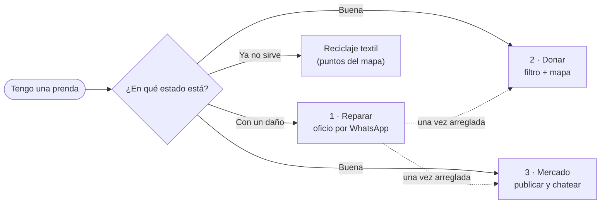

# La idea en una página

> Si tienes que explicar Hilo Circular en tres minutos, este es el documento. Todo lo demás en `docs/` lo profundiza.

## En una frase

**Hilo Circular evita que la ropa que todavía sirve termine en la basura: te conecta con quien la repara, con quien la necesita y con quien la quiere comprar, en La Serena y Coquimbo.**

## El problema, en tres líneas

1. En 2021 llegaron a Chile cerca de **156 mil toneladas** de ropa usada y alrededor del **60 %** terminó en vertederos del desierto de Atacama (CEPAL, datos preliminares).
2. En cada ciudad se repite el patrón: se bota ropa que se podía arreglar, los oficios de reparación de barrio no tienen presencia digital y las fundaciones reciben donaciones que no les sirven.
3. La ropa que alguien deja de usar casi nunca llega a otra persona que sí la usaría.

## La solución: tres caminos, una sola plataforma

Cada camino es una pantalla y responde a una pregunta concreta. No hay nada más.

| Camino | Pregunta que responde | Qué hace la persona | Cómo se contacta |
|---|---|---|---|
| **1 · Reparar** | "Se me rompió, ¿quién me lo arregla?" | Busca oficios (costura, zapatería, tejido…) filtrando por comuna, oficio y prenda | WhatsApp directo al oficio |
| **2 · Donar** | "Ya no la uso, ¿dónde la dejo?" | Pasa un **filtro de calidad** de 5 preguntas y elige en un **mapa** (con la lista de puntos a la derecha) dónde llevarla | Avisa en la plataforma que va a donar; la fundación confirma al recibir |
| **3 · Mercado** | "Ya no la uso, pero alguien la compraría" | Publica la prenda con fotos, o compra una | **Chat interno** entre comprador y vendedor y, si el vendedor quiere, WhatsApp |
| **4 · Impacto** | "¿Cuánto estamos logrando juntos?" | Consulta indicadores agregados de reparación, donación, mercado y reparto | Cifras públicas actualizadas desde la plataforma |
| **5 · Delivery** | "¿Cómo coordino un traslado local?" | Filtra repartidores activos por comuna u ofrece reparto con tu perfil | Contacto directo por WhatsApp o teléfono registrado por zona |

Si la persona no sabe qué camino tomar, un asistente de dos preguntas ("¿qué prenda es?" y "¿en qué estado está?") la deriva al correcto, siguiendo la **jerarquía de residuos**: primero reutilizar (donar o vender), luego reparar y solo al final reciclar.

## Para quién

| Persona | Qué gana |
|---|---|
| Vecinas y vecinos de La Serena y Coquimbo | Saber qué hacer con su ropa, ahorrar arreglando y ganar algo vendiendo |
| Oficios de reparación (muchos adultos mayores) | Clientes nuevos y presencia digital gratis, por el canal que ya usan: WhatsApp |
| Fundaciones y puntos de acopio | Donaciones que sí les sirven y menos ropa que botar a su costo |

## Lo que **no** es (alcance)

Decir que no ordena el proyecto tanto como decir que sí:

- **No procesa pagos.** El mercado conecta personas; el pago y la entrega se acuerdan entre ellas.
- **No intermedia pagos ni flotas propias:** todo el contacto (reparación, compra o coordinación de reparto por comuna) es local y directo entre vecinos.
- **No reemplaza a WhatsApp**: lo usa. El chat interno existe para quien no quiere publicar su número.
- **No es una tienda** ni cobra comisión a nadie.
- **Solo La Serena y Coquimbo** durante el piloto.

## Cómo medimos el impacto

Una cifra por camino, visibles en vivo en `/impacto`:

| Camino | Indicador |
|---|---|
| Reparar | Contactos a oficios por WhatsApp (reparaciones iniciadas) |
| Donar | Donaciones confirmadas por la fundación y **kg de textil recuperado** (estimado por tipo de prenda) |
| Mercado | Prendas publicadas y **prendas que cambiaron de dueño** (marcadas como vendidas) |
| Delivery | Contactos de reparto iniciados por comuna (`contactosDelivery`) |

## Guion de demo (3 minutos)

Con `npm run dev` y la cuenta demo `demo@hilocircular.cl` / `hilo2026`:

1. **Inicio:** el titular y las dos cifras del problema; mostrar los tres caminos en la grilla.
2. **Reparar:** filtrar por "Zapatería" y pulsar "Escribir por WhatsApp" (abre el mensaje ya escrito).
3. **Donar:** marcar las 5 casillas del filtro; elegir un punto en el mapa y ver cómo la lista de la derecha se abre en ese punto. Mostrar "Reciclar textil" para la ropa que no pasa el filtro.
4. **Mercado:** entrar con la cuenta demo, abrir la parka, enviar un mensaje por el chat y mostrar la conversación.
5. **Fundación:** cerrar sesión y entrar con `fundacion@hilocircular.cl` / `hilo2026`. En "Mi fundación" pulsar "Ya la recibimos" en una donación pendiente: los kilos de impacto suben en vivo.
6. **Publicar:** subir una prenda con foto desde el celular y marcarla como vendida.
7. **Impacto:** cerrar con las cifras en vivo.

## Quién hace qué

| Área | Responsable |
|---|---|
| Reparar (búsqueda, perfil de oficio, "Mi taller") | Bastian |
| Donar (mapa, puntos, panel de fundación) y datos | Hector |
| Mercado, cuentas, chat, API y pruebas | Joshua |
| Documentación, presentación y pruebas con usuarios | Todo el equipo |
