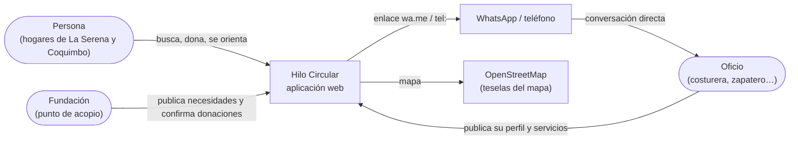
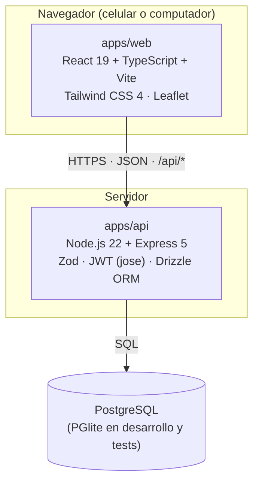
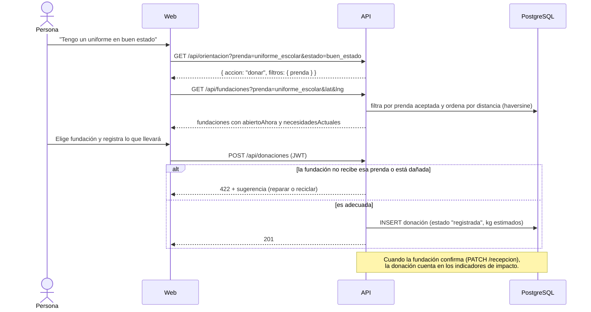

# Arquitectura

Hilo Circular es una aplicación web de tres capas, igual a la presentada en el Hito 1: frontend SPA, API REST y base de datos relacional. Este documento detalla esa arquitectura y registra las decisiones que se tomaron al implementarla.

## 1. Vista de contexto



La plataforma **no intermedia** la conversación ni el pago. Solo entrega el enlace de contacto y registra que hubo un contacto, para medir el impacto.

## 2. Vista de contenedores



| Capa | Tecnología | Por qué |
|---|---|---|
| Frontend | React 19, TypeScript, Vite 8 | Lo presentado en el Hito 1; ecosistema que el equipo conoce; Vite compila al instante |
| Estilos | Tailwind CSS 4 con tokens propios | Los tokens del sistema de diseño viven en un solo archivo CSS (`apps/web/src/estilos.css`) |
| Componentes | shadcn/ui, a medida que se necesiten | Componentes accesibles (Radix) que se copian al repo y se adaptan a nuestros tokens |
| Mapa | Leaflet + OpenStreetMap | Gratuito, sin API key, funciona bien en celulares de gama baja |
| API | Node.js 22, Express 5 | Express 5 captura los errores de funciones `async` sin código extra |
| Validación | Zod 4 | Un solo esquema valida la entrada y genera los tipos de TypeScript |
| ORM | Drizzle ORM + drizzle-kit | SQL explícito y tipado; las migraciones se versionan como archivos `.sql` en `apps/api/drizzle/` |
| Base de datos | PostgreSQL | Relacional, como se presentó. La distancia se calcula con la fórmula del haversine en SQL, sin depender de PostGIS |
| BD local | PGlite (PostgreSQL compilado a WebAssembly) | Nadie del equipo necesita instalar PostgreSQL ni Docker: `npm run dev` y listo. Los tests usan una base en memoria nueva por archivo |
| Autenticación | JWT HS256 con `jose` | Sin estado en el servidor; el rol viaja en el token |
| Calidad | Vitest + Supertest, Biome, GitHub Actions | 44 tests de integración HTTP; lint y formato con una sola herramienta; CI en cada PR |

## 3. Estructura del repositorio

```text
hilo-circular/
├── apps/
│   ├── api/                 # API REST (Joshua: estructura y endpoints · Hector: autenticación y esquema)
│   │   ├── drizzle/         # Migraciones SQL generadas
│   │   ├── src/
│   │   │   ├── db/          # esquema, conexión, migración y datos demo
│   │   │   ├── lib/         # catálogo del dominio, errores, geografía, horarios
│   │   │   ├── middleware/  # autenticación por roles y manejo de errores
│   │   │   └── modules/     # un módulo por recurso: rutas + esquemas + servicio
│   │   └── test/            # tests de integración (PGlite en memoria)
│   └── web/                 # SPA (Bastian: búsqueda e interfaz · Hector: mapa)
├── docs/                    # fundamentación, arquitectura, casos de uso, mockups, entregas
└── .github/                 # CI, plantillas de issues y PR
```

Cada módulo de la API sigue la misma forma: `esquemas.ts` (validación con Zod), `servicio.ts` (consultas y reglas de negocio) y `rutas.ts` (HTTP). Las reglas de negocio no dependen de Express, por lo que se pueden probar por separado.

## 4. Flujo principal: donar una prenda



## 5. Seguridad y privacidad

- **Roles:** `persona`, `oficio`, `fundacion` y `admin`. Cada endpoint de escritura declara qué roles acepta (`requiereSesion("oficio")`) y además comprueba que el recurso pertenezca a quien lo edita.
- **Ubicación aproximada por defecto:** la API redondea a 2 decimales (~1 km) las coordenadas de los oficios que no eligieron ubicación exacta y nunca expone su dirección ni su número de teléfono. El número solo se entrega dentro del enlace de contacto.
- **Validación estricta:** todo dato de entrada pasa por Zod. Los errores responden con un formato uniforme: `{ error: { codigo, mensaje, detalles } }`.
- **Cabeceras seguras:** se usa `helmet`, CORS restringido al origen del frontend y un límite de 100 kB por solicitud.
- **Secretos:** en producción `JWT_SECRET` es obligatorio; la API no arranca sin él.
- **Pendiente (issue de Hector):** hash de contraseñas con `node:crypto` scrypt y límite de intentos de inicio de sesión.

## 6. Despliegue propuesto

| Componente | Opción gratuita sugerida |
|---|---|
| Frontend (archivos estáticos) | Netlify, Vercel o GitHub Pages |
| API (Node.js) | Render o Railway |
| PostgreSQL administrado | Neon o Supabase (capa gratuita) |

La API cambia de PGlite a PostgreSQL definiendo una sola variable, `DATABASE_URL`. Las mismas migraciones corren en ambos motores.

## 7. Registro de decisiones

| # | Decisión | Alternativas consideradas | Motivo |
|---|---|---|---|
| D1 | Express 5 en lugar de NestJS o Fastify | NestJS, Fastify | Menor curva de aprendizaje para el equipo; suficiente para el tamaño del MVP |
| D2 | Drizzle en lugar de Prisma | Prisma, SQL puro | Funciona igual con PGlite y con PostgreSQL; consultas SQL legibles; sin binarios nativos |
| D3 | PGlite para desarrollo y tests | Docker con PostgreSQL, SQLite | Cero instalación en Windows; es PostgreSQL real, a diferencia de SQLite, que tiene otro dialecto |
| D4 | Haversine en SQL en lugar de PostGIS | PostGIS | PGlite no trae PostGIS; para cientos de puntos a escala ciudad el rendimiento sobra |
| D5 | Contacto por WhatsApp en lugar de un chat propio | Chat interno | Es como ya trabajan los oficios; reduce la complejidad y la brecha digital |
| D6 | Monorepo con npm workspaces | Repos separados, pnpm o turborepo | Un solo `npm install`; sin herramientas extra que aprender |
| D7 | Biome en lugar de ESLint + Prettier | ESLint + Prettier | Una sola herramienta, sin configuración extensa |
