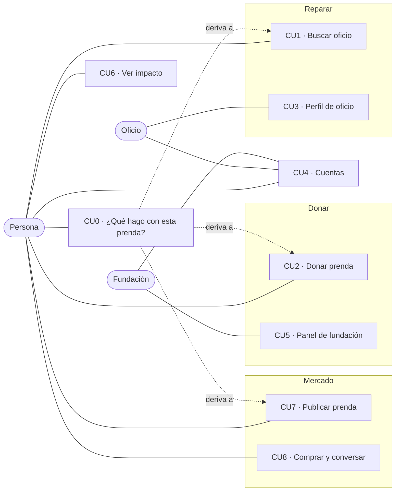

# Casos de uso

Los casos de uso se ordenan según los **tres caminos** de [00 · La idea](00-la-idea.md). Cada camino es una pantalla de la aplicación; los casos transversales los sostienen.

| Camino | Casos de uso | Pantalla |
|---|---|---|
| **1 · Reparar** | CU1 Buscar oficio · CU3 Gestionar perfil de oficio | `/reparar`, `/reparar/:id`, `/mi-taller` |
| **2 · Donar** | CU2 Donar prenda · CU5 Panel de fundación | `/donar` |
| **3 · Mercado** | CU7 Publicar una prenda · CU8 Comprar y conversar | `/mercado`, `/mercado/:id`, `/mercado/publicar`, `/mensajes` |
| Transversales | CU0 ¿Qué hago con esta prenda? · CU4 Cuentas · CU6 Ver impacto | `/`, `/ingresar`, `/impacto` |

| CU | Responsable de la interfaz | Endpoints | Estado |
|---|---|---|---|
| CU0 | Base del proyecto | `GET /orientacion`, `GET /catalogo` | Hecho |
| CU1 | Bastian | `GET /oficios`, `GET /oficios/:id`, `POST /oficios/:id/contacto` | Hecho |
| CU2 | Joshua (filtro, mapa y lista) | `GET /fundaciones`, `POST /donaciones` | Hecho |
| CU3 | Bastian | `POST /oficios`, `PATCH /oficios/yo`, `/oficios/yo/servicios` | Hecho |
| CU4 | Joshua | `POST /auth/registro`, `POST /auth/ingreso`, `GET /auth/yo` | Hecho |
| CU5 | Hector | `PATCH /fundaciones/yo`, `GET /donaciones/mias`, `PATCH /donaciones/:id/recepcion` | API lista, falta la pantalla |
| CU6 | Base del proyecto | `GET /impacto` | Hecho |
| CU7 | Joshua | `POST /mercado`, `GET /mercado/mias`, `PATCH /mercado/:id`, `DELETE /mercado/:id` | Hecho |
| CU8 | Joshua | `GET /mercado`, `GET /mercado/:id`, `POST /mercado/:id/conversacion`, `/conversaciones/*` | Hecho |

---

## CU0 — ¿Qué hago con esta prenda?

- **Actor:** Persona, sin necesidad de iniciar sesión.
- **Objetivo:** recibir una recomendación concreta antes de botar una prenda.

**Flujo principal**

1. La persona elige el tipo de prenda entre 10 opciones con etiquetas en lenguaje simple.
2. Indica en qué estado está: en buen estado, con un daño reparable o muy deteriorada.
3. El sistema recomienda:
   - **donar**, si está en buen estado;
   - **reparar**, con el oficio que corresponde: calzado → zapatería, bolso → marroquinería, sweater → tejido;
   - **reciclar**, si está muy deteriorada.
4. Un botón lleva a CU1 o CU2 con los filtros ya aplicados.

**Reglas**

- La recomendación sigue la jerarquía de residuos.
- Nunca recomienda donar una prenda deteriorada a una fundación que no la recibe.

## CU1 — Buscar oficio

- **Actor:** Persona.
- **Precondición:** ninguna. Para ordenar por cercanía se pide permiso de ubicación; si se niega, se puede elegir la comuna.

**Flujo principal**

1. La persona filtra por tipo de arreglo y de prenda, o escribe lo que necesita ("cierre", "basta").
2. El sistema lista los oficios ordenados por distancia. Cada uno muestra:
   - sus servicios y su precio referencial;
   - la distancia aproximada;
   - si está verificado por el equipo.
3. La persona abre un perfil y pulsa "Contactar por WhatsApp".
4. El sistema registra el contacto y abre WhatsApp con un mensaje ya escrito.

**Flujos alternativos**

- **1a.** Sin resultados en el radio: se sugiere ampliar el radio o quitar filtros.
- **3a.** El oficio no tiene WhatsApp: se ofrece llamar por teléfono.

**Reglas**

- Si el oficio eligió ubicación aproximada, se muestra un área de ~1 km y no su dirección.

## CU2 — Donar prenda

- **Actor:** Persona. Ver el mapa no necesita cuenta; avisar que va a donar, sí.

**Flujo principal**

1. **Filtro de calidad.** La persona responde cinco preguntas sobre su prenda: está limpia y seca; no tiene manchas, hoyos ni roturas; cierres, botones y costuras funcionan; no es ropa interior ni traje de baño usado; ella misma la volvería a usar. Opcionalmente indica qué prenda es.
2. Con las cinco respuestas en "sí", el sistema muestra el **mapa** de La Serena y Coquimbo y, a la derecha, la **lista** de puntos que reciben esa prenda. Se puede filtrar por comuna y por "abierto ahora".
3. Al elegir un punto (en el mapa o en la lista) se ven sus necesidades actuales, su horario, su dirección, lo que recibe y un enlace "Cómo llegar".
4. Pulsa "Voy a donar aquí", indica prenda y cantidad, y el sistema registra la donación.
5. Cuando la fundación confirma la recepción (CU5), la donación suma a los indicadores (CU6).

**Flujos alternativos**

- **1a.** Alguna respuesta es "no": se ofrece repararla (CU1, con la prenda ya filtrada) o llevarla a un punto de **reciclaje textil** (el mapa cambia a los puntos que aceptan textiles dañados).
- **4a.** La fundación no recibe esa prenda: se avisa cuál y no se registra.
- **4b.** Sin sesión: se pide ingresar (CU4) y se vuelve a `/donar`.

## CU3 — Gestionar perfil de oficio

- **Actor:** Oficio con sesión iniciada. Puede ser asistido presencialmente por el equipo.

**Flujo principal**

1. El oficio ingresa su nombre público, comuna, ubicación (marcando un punto en el mapa) y WhatsApp.
2. Elige la privacidad de su ubicación: aproximada (opción por defecto) o exacta con dirección.
3. Agrega servicios: categoría, título, prendas que trabaja y "precio desde" (o "a convenir").
4. Puede pausar su perfil (`activo = false`) cuando no esté recibiendo trabajos.

**Reglas**

- Solo puede existir un perfil por usuario.
- Debe tener al menos un medio de contacto.
- El celular se valida con formato chileno (+56 9 …).

## CU4 — Cuentas

- **Actores:** Persona, Oficio y Fundación.
- **Flujo:** registro con nombre, correo, contraseña y rol (persona u oficio); inicio de sesión; cierre de sesión.
- Las cuentas de fundación no se crean desde el registro público: las crea el equipo al verificar que la organización existe.

**Reglas**

- Las contraseñas se guardan con hash scrypt y sal aleatoria.
- Un correo inexistente y una contraseña incorrecta reciben el mismo mensaje, para no revelar qué correos están registrados.
- El token de sesión expira a los 7 días.
- Cada acción verifica el rol y la propiedad del recurso.
- Una fundación nueva queda "sin verificar" hasta que el equipo la valide.

## CU5 — Panel de fundación

- **Actor:** Fundación con sesión iniciada.

**Flujo principal**

1. Actualiza sus necesidades actuales (por ejemplo, "parkas de niño").
2. Actualiza sus horarios y las prendas que acepta.
3. Ve las donaciones registradas hacia ella y confirma las que recibió.

**Reglas**

- Solo puede confirmar las donaciones dirigidas a ella.
- Una donación se confirma una sola vez.

## CU6 — Ver impacto

- **Actor:** cualquier visitante.
- **Flujo:** la página de inicio y `/impacto` muestran los oficios activos, los puntos de donación, los contactos para reparar, las donaciones confirmadas, los kilos de textil recuperados (estimados), las prendas publicadas en el mercado y las que cambiaron de dueño.

## CU7 — Publicar una prenda

- **Actor:** Persona u Oficio con sesión iniciada.

**Flujo principal**

1. Sube hasta 4 fotos. El navegador las reduce a 1200 px en JPEG antes de enviarlas, para que suban rápido con datos móviles.
2. Completa título, tipo de prenda, talla, estado (nueva con etiqueta, como nueva, buen estado o con detalles), precio o "la regalo", comuna y una descripción opcional.
3. Decide si también quiere que le escriban por WhatsApp. Si no, su número queda privado y solo la contactan por el chat.
4. Una vista previa muestra cómo se verá la publicación. Al publicar, se abre su página.
5. Desde "Mis publicaciones" la marca como **reservada** o **vendida**, o la elimina.

**Reglas**

- Una publicación vendida sale del listado público y suma a "prendas que cambiaron de dueño" (CU6).
- La API revisa la firma real de cada archivo (JPEG, PNG o WebP) y rechaza fotos de más de 700 KB.
- Solo quien publicó puede modificarla.

## CU8 — Comprar y conversar

- **Actor:** Persona. Mirar no necesita cuenta; escribir, sí.

**Flujo principal**

1. Busca prendas por texto, tipo, comuna o "se regala", y ordena por fecha o precio.
2. Abre una prenda y ve sus fotos, estado, talla, descripción y quién la publicó.
3. Escribe por el **chat** (con respuestas rápidas como "¿Sigue disponible?") o, si el vendedor lo permitió, por **WhatsApp**.
4. La conversación queda en `/mensajes`, donde ambos ven el historial y los mensajes sin leer. El menú muestra un globo con los no leídos.
5. Acuerdan el pago y la entrega fuera de la plataforma, en persona.

**Reglas**

- Hay una sola conversación por comprador y prenda; volver a escribir la retoma.
- Nadie puede abrir un chat con su propia publicación ni leer una conversación ajena.
- Una prenda vendida no admite conversaciones nuevas.
- La página muestra consejos de seguridad: juntarse en un lugar público y no transferir por adelantado.

