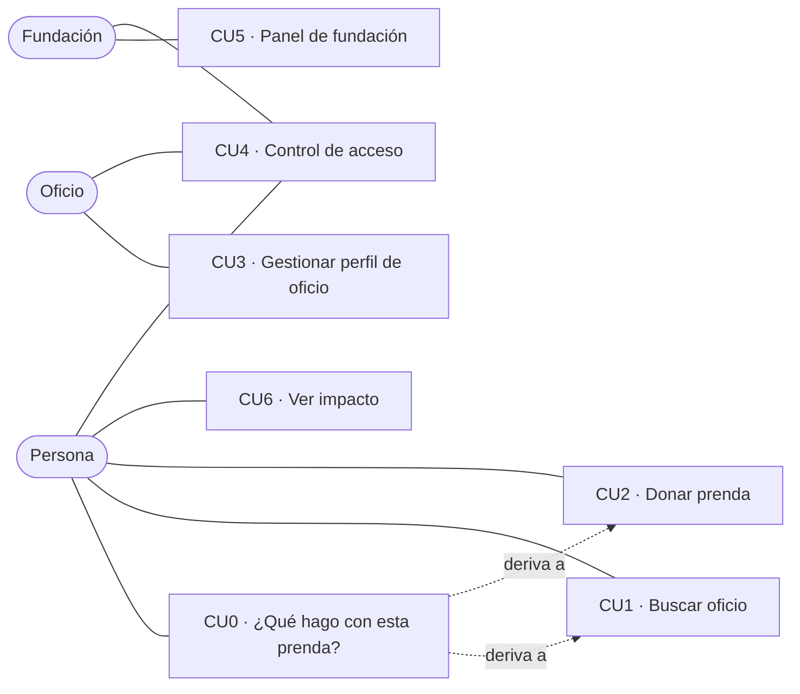

# Casos de uso

El Hito 1 presentó CU1 a CU4. Al profundizar el análisis se agregaron tres más:

- **CU0, asistente de orientación.** Hace de puerta de entrada y aplica la jerarquía de residuos.
- **CU5, panel de fundación.** Sin él, nadie mantiene actualizada la información de "qué reciben".
- **CU6, indicadores de impacto.** Hacen medible el aporte social.

| CU | Responsable de la interfaz | Endpoints (API lista) | Mockup |
|---|---|---|---|
| CU0 | Base del proyecto (hecho) | `GET /orientacion`, `GET /catalogo` | Implementado en la pantalla de inicio |
| CU1 | Bastian | `GET /oficios`, `GET /oficios/:id`, `POST /oficios/:id/contacto` | [mockups/oficios.html](mockups/oficios.html) |
| CU2 | Hector (mapa) y Joshua (flujo) | `GET /fundaciones`, `POST /donaciones` | [mockups/donar.html](mockups/donar.html) |
| CU3 | Bastian | `POST /oficios`, `PATCH /oficios/yo`, `/oficios/yo/servicios` | [mockups/oficios.html](mockups/oficios.html) |
| CU4 | Hector | `/auth/*` (pendiente), middleware `requiereSesion` (hecho) | — |
| CU5 | Hector | `PATCH /fundaciones/yo`, `GET /donaciones/mias`, `PATCH /donaciones/:id/recepcion` | — |
| CU6 | Base del proyecto (hecho) | `GET /impacto` | Implementado en inicio y en `/impacto` |

---

## CU0 — ¿Qué hago con esta prenda?

- **Actor:** Persona, sin necesidad de iniciar sesión.
- **Objetivo:** recibir una recomendación concreta antes de botar una prenda.

**Flujo principal**

1. La persona elige el tipo de prenda entre 10 opciones con etiquetas en lenguaje simple.
2. Indica en qué estado está: en buen estado, con un daño reparable o muy deteriorada.
3. El sistema recomienda:
   - **donar**, si está en buen estado;
   - **reparar**, con el oficio que corresponde: calzado → zapatería, bolso → marroquinería, sweater → tejido;
   - **reciclar**, si está muy deteriorada.
4. Un botón lleva a CU1 o CU2 con los filtros ya aplicados.

**Reglas**

- La recomendación sigue la jerarquía de residuos.
- Nunca recomienda donar una prenda deteriorada a una fundación que no la recibe.

## CU1 — Buscar oficio

- **Actor:** Persona.
- **Precondición:** ninguna. Para ordenar por cercanía se pide permiso de ubicación; si se niega, se puede elegir la comuna.

**Flujo principal**

1. La persona filtra por tipo de arreglo y de prenda, o escribe lo que necesita ("cierre", "basta").
2. El sistema lista los oficios ordenados por distancia. Cada uno muestra:
   - sus servicios y su precio referencial;
   - la distancia aproximada;
   - si está verificado por el equipo.
3. La persona abre un perfil y pulsa "Contactar por WhatsApp".
4. El sistema registra el contacto y abre WhatsApp con un mensaje ya escrito.

**Flujos alternativos**

- **1a.** Sin resultados en el radio: se sugiere ampliar el radio o quitar filtros.
- **3a.** El oficio no tiene WhatsApp: se ofrece llamar por teléfono.

**Reglas**

- Si el oficio eligió ubicación aproximada, se muestra un área de ~1 km y no su dirección.

## CU2 — Donar prenda

- **Actor:** Persona.
- **Mockup:** [mockups/donar.html](mockups/donar.html).

**Flujo principal**

1. La persona ve el mapa y la lista de fundaciones cercanas. Puede filtrar por prenda y por "abierto ahora".
2. Abre una fundación y ve:
   - sus necesidades actuales, destacadas;
   - sus horarios;
   - las prendas que acepta y si recibe prendas dañadas.
3. Pulsa "Voy a donar" e indica qué llevará: prenda, cantidad y estado. Para registrar debe iniciar sesión (CU4).
4. El sistema valida la donación. Si es adecuada, la registra y muestra cómo llegar y el horario.
5. Cuando la fundación confirma la recepción (CU5), la donación suma a los indicadores (CU6).

**Flujos alternativos**

- **4a.** La fundación no recibe alguna prenda: se avisa cuál y se ofrecen otras fundaciones que sí la reciben.
- **4b.** Hay una prenda dañada y la fundación no la acepta: se recomienda repararla y se muestra el oficio más cercano. Así la donación inservible no llega a la fundación.

## CU3 — Gestionar perfil de oficio

- **Actor:** Oficio con sesión iniciada. Puede ser asistido presencialmente por el equipo.

**Flujo principal**

1. El oficio ingresa su nombre público, comuna, ubicación (marcando un punto en el mapa) y WhatsApp.
2. Elige la privacidad de su ubicación: aproximada (opción por defecto) o exacta con dirección.
3. Agrega servicios: categoría, título, prendas que trabaja y "precio desde" (o "a convenir").
4. Puede pausar su perfil (`activo = false`) cuando no esté recibiendo trabajos.

**Reglas**

- Solo puede existir un perfil por usuario.
- Debe tener al menos un medio de contacto.
- El celular se valida con formato chileno (+56 9 …).

## CU4 — Control de acceso

- **Actores:** Persona, Oficio y Fundación.
- **Flujo:** registro con nombre, correo, contraseña y rol; inicio de sesión; cierre de sesión.

**Reglas**

- Las contraseñas se guardan con hash.
- El token de sesión expira a los 7 días.
- Cada acción verifica el rol y la propiedad del recurso.
- Una fundación nueva queda "sin verificar" hasta que el equipo la valide.

## CU5 — Panel de fundación

- **Actor:** Fundación con sesión iniciada.

**Flujo principal**

1. Actualiza sus necesidades actuales (por ejemplo, "parkas de niño").
2. Actualiza sus horarios y las prendas que acepta.
3. Ve las donaciones registradas hacia ella y confirma las que recibió.

**Reglas**

- Solo puede confirmar las donaciones dirigidas a ella.
- Una donación se confirma una sola vez.

## CU6 — Ver impacto

- **Actor:** cualquier visitante.
- **Flujo:** la página de inicio y `/impacto` muestran los oficios activos, los puntos de donación, los contactos para reparar, las donaciones confirmadas y los kilos de textil recuperados (estimados).
