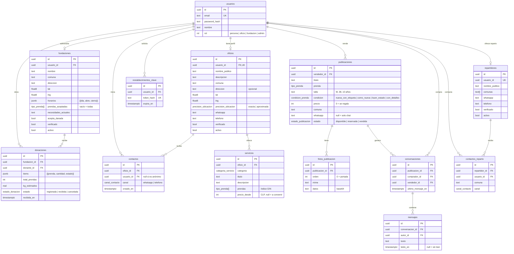

# Modelo de datos

La fuente de verdad es [`apps/api/src/db/schema.ts`](../apps/api/src/db/schema.ts). Las migraciones SQL generadas desde ese esquema están en [`apps/api/drizzle/`](../apps/api/drizzle/).

Todas las tablas, salvo `contactos`, `fotos_publicacion`, `conversaciones` y `mensajes`, tienen `creado_en` y `actualizado_en`.

## Decisiones de modelado

- **Vocabulario controlado.** Las categorías de oficio, los tipos de prenda y los estados son *enums* de PostgreSQL. Se definen una sola vez en [`apps/api/src/lib/catalogo.ts`](../apps/api/src/lib/catalogo.ts), junto con sus etiquetas en español y el peso promedio de cada prenda. El frontend obtiene ese catálogo desde `GET /api/catalogo`, así que no duplica listas.
- **Oficio y servicios por separado.** Un mismo taller puede ofrecer costura *y* marroquinería, con precios distintos. La búsqueda filtra por servicio (categoría y prenda) y devuelve el oficio.
- **`prendas_aceptadas` vacío significa "acepta todo".** Así una fundación general no tiene que marcar las 10 opciones.
- **Las donaciones guardan los ítems como JSONB.** Una donación es un registro inmutable de lo que se entregó y no se consulta ítem por ítem, así que una tabla adicional no aportaba.
- **`kg_estimados` se calcula al registrar la donación.** Si se recalibran los pesos promedio, las donaciones históricas conservan el valor con que se registraron.
- **`contactos` es la evidencia de "reparaciones iniciadas".** La reparación ocurre fuera de la plataforma, así que el clic en "Contactar" es el indicador observable más honesto.
- **Las fotos del mercado van en su propia tabla, en base64.** Así los listados no las arrastran y el despliegue no necesita un servicio de archivos aparte. Cada foto llega reducida a ~1200 px desde el navegador (máx. 700 KB). Si el mercado crece, se mueven a un bucket sin cambiar la API (`/mercado/fotos/:id`).
- **Una conversación por comprador y prenda** (índice único `publicacion_id + comprador_id`). Guardar también `vendedor_id` evita un *join* para armar la bandeja de entrada.
- **"Sin leer" es `leido_en IS NULL`.** No hace falta una tabla de estados por participante, porque cada conversación tiene exactamente dos personas.
- **Coordenadas como `float8`.** No se usa PostGIS, para que el mismo esquema funcione en PGlite (ver decisión D4 en [02-arquitectura.md](02-arquitectura.md)).
- **Delivery por comuna.** `repartidores.comunas` usa `text[]` con índice GIN para filtrar por cobertura local sin inventar repartidores ficticios; `contactos_reparto` registra cada contacto iniciado por comuna.
- **Recuperación de contraseña con hash.** `restablecimientos_clave` guarda el hash del token (`token_hash`), con expiración a los 30 minutos y consumo de un solo uso al restablecer la clave.

## Cambios al modelo

1. Editar `apps/api/src/db/schema.ts`.
2. Generar la migración con `npm run db:generate -w @hilo/api -- --name descripcion_del_cambio`.
3. Revisar el archivo `.sql` generado y subirlo junto con el cambio de esquema en el mismo PR.
